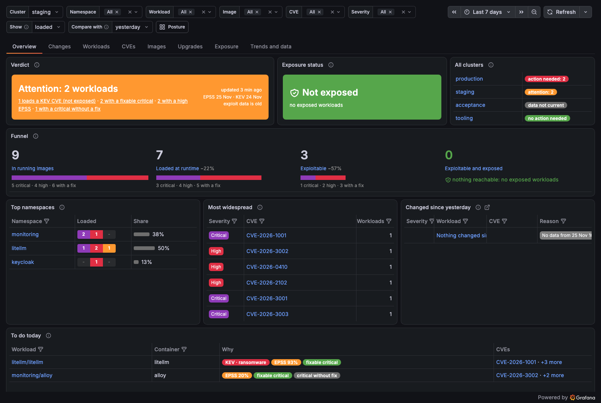
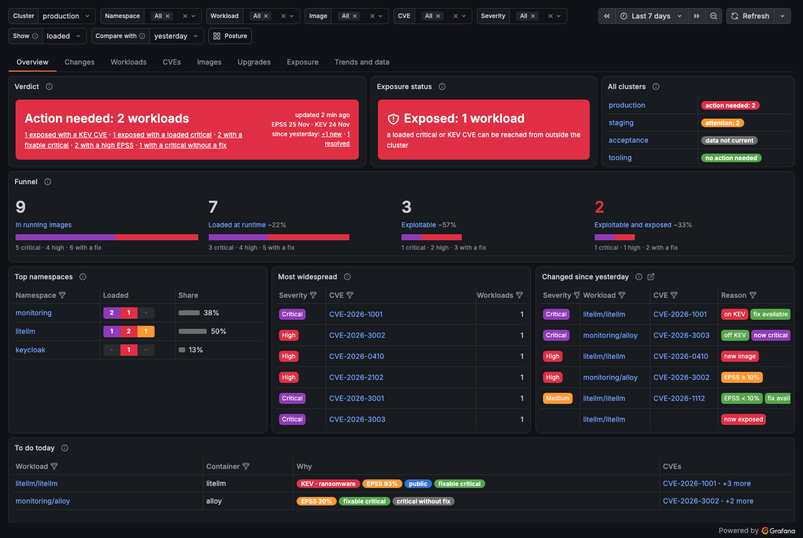
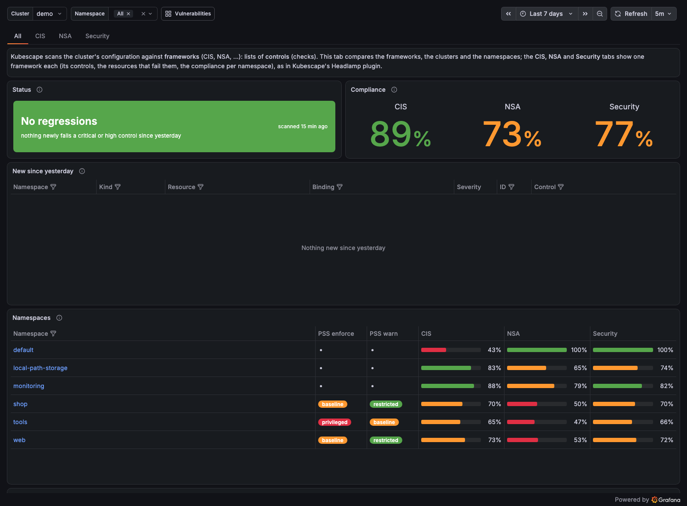

# kubescape-findings-exporter



Prometheus exporter for the scan results of the [Kubescape operator](https://kubescape.io/): one series per CVE, per
image and per workload container that loads it at runtime, and the configuration scan (posture) results per control,
resource and framework. The Kubescape exporter itself only has counts per severity.

## Installation

Install the chart in the namespace of the Kubescape operator:

```bash
helm install kubescape-findings-exporter oci://ghcr.io/warpnet/charts/kubescape-findings-exporter \
  --namespace kubescape
```

The Kubescape operator needs the `vulnerabilityScan` and `configurationScan` capabilities, and `relevancy` with
`runtimeObservability` for the series of the packages a container loads. Relevancy needs a node kernel with
`CONFIG_FANOTIFY_ACCESS_PERMISSIONS`; without it (Docker Desktop, for one) only the image series are there, and the
Vulnerabilities dashboard, which starts from the workloads, stays empty.

The chart has a `ServiceMonitor` for the Prometheus operator; see `chart/values.yaml` for all options. With
kube-prometheus-stack it needs the label its `serviceMonitorSelector` matches:

```yaml
serviceMonitor:
  enabled: true
  labels:
    release: kube-prometheus-stack
```

## Dashboards and alerts

`dashboards/` has two Grafana dashboards: **Vulnerabilities** (`kubescape-vulnerabilities.json`: what to fix now,
per workload, image and CVE, with relevancy, EPSS, KEV and exposure) and **Posture** (`kubescape-posture.json`:
compliance per framework, CIS section, control, namespace and resource).

<details>
<summary>Screenshot: Vulnerabilities, exposed and not exposed</summary>




*On synthetic test data (the CVE IDs are made up): the same CVEs loaded in the same images on two clusters. On
`production` a workload with a loaded critical and KEV CVE can be reached from outside the cluster: action needed
(red). On `staging` nothing is exposed: the same CVEs only need attention (orange).*

</details>

<details>
<summary>Screenshot: Posture</summary>



*On a kind cluster with a few outdated public images.*

</details>

They need:

- Grafana 13 or newer: they are v2 dashboards (`apiVersion: dashboard.grafana.app/v2`) and use SQL expressions.
- A Prometheus datasource with the uid `prometheus`.
- The recording rules of the chart's `PrometheusRule` (below) and
  [kube-state-metrics](https://github.com/kubernetes/kube-state-metrics).
- A `cluster` label on the series if one Prometheus holds several clusters; the `Cluster` variable selects one.
- For the Pod Security Standard of each namespace on the Posture dashboard: kube-state-metrics with
  `--metric-labels-allowlist=namespaces=[pod-security.kubernetes.io/enforce,pod-security.kubernetes.io/warn]`
  (`kube-state-metrics.metricLabelsAllowlist` in kube-prometheus-stack).
- Kubescape in the namespace `kubescape` for the daily-scan status on the Vulnerabilities dashboard (it reads the
  `kubevuln-scheduler` CronJob there); the alerts use the chart's Kubescape namespace.
- Higher SQL expression limits on a larger cluster or with several clusters (below).

A Grafana SQL expression refuses more than 100,000 input or output cells (rows × columns) by default; a panel over
the limit shows `[sse.sql.input_limit_exceeded]`. The default view of the Vulnerabilities dashboard stays well below
that, but Show all with a namespace selected and the Changes tab can pass it. Raise the limits in `grafana.ini`:

```ini
[expressions]
sql_expression_cell_limit = 250000
sql_expression_output_cell_limit = 250000
```

With kube-prometheus-stack that is `grafana."grafana.ini".expressions` in its values. The cells are held in Grafana's
memory while an expression runs, so give Grafana room before raising them further: Grafana 13 alone idles at around
420Mi, and these dashboards need a memory limit of a few Gi.

The dashboard JSON is generated by a script outside this repository: propose a change in an issue or pull request,
and the maintainers carry it over to the generator.

The `PrometheusRule` has the recording rules the dashboards read and the alerts. Switch it on with:

```yaml
prometheusRule:
  enabled: true
  labels:
    release: kube-prometheus-stack   # whatever your Prometheus ruleSelector matches
  grafanaURL: https://grafana.example.com   # adds a dashboard_url annotation to the alerts
```

| Alert | Severity | Fires when |
|-------|----------|------------|
| `VulnerabilityRelevantCriticalExposed` | critical | a container loads a critical CVE and the workload can be reached from outside the cluster |
| `VulnerabilityRelevantKEVExposed` | critical | a container loads a CVE on CISA's KEV list and the workload can be reached from outside the cluster |
| `VulnerabilityRelevantCriticalFixable` | warning | a container loads a critical CVE with a fixed version |
| `VulnerabilityRelevantKEV` | warning | a container loads a CVE on CISA's KEV list |
| `VulnerabilityRelevantHighEPSS` | warning | a container loads a CVE with an EPSS of 10% or more |
| `VulnerabilityRelevantCriticalUnfixed` | info | a container loads a critical CVE without a fix |
| `PostureRegression` | warning | resources newly fail a critical or high control since yesterday |
| `KubescapeCveExporterFailing`, `KubescapeCveFeedStale`, `KubescapeCveFeedDataOld`, `KubescapeDailyScanMissing`, `KubescapePostureScanStale` | warning | the exporter, a feed or a Kubescape scan is stale |

The vulnerability alerts only count CVEs in packages a container loads at runtime, of Deployments, StatefulSets and
DaemonSets. To get only the critical alert for an exposed container, not also the warning or info one, add this
Alertmanager inhibit rule:

```yaml
inhibit_rules:
  - source_matchers:
      - alertname = "VulnerabilityRelevantCriticalExposed"
    target_matchers:
      - alertname =~ "VulnerabilityRelevantCriticalFixable|VulnerabilityRelevantCriticalUnfixed"
    equal: [cluster, namespace, workload, container]
```

## Metrics

The `kubescape_cve_exporter_*` metric names keep the old prefix on purpose, so existing dashboards and alerts keep working.

All series have the value 1 (count them), except the timestamps and `kubescape_posture_control_resources`.

| Metric | One series per | Labels |
|--------|----------------|--------|
| `kubescape_image_info` | image digest | `image`, `digest`, `tag` |
| `kubescape_image_vulnerability` | digest, CVE, package, version | `image`, `digest`, `tag`, `cve`, `severity`, `package`, `version`, `fixed_version`, `fix_state` |
| `kubescape_workload_vulnerability_relevant` | workload container, digest, CVE, package, version (loaded packages only) | `namespace`, `workload`, `kind`, `container`, `digest`, `cve`, `package`, `version` |
| `kubescape_cve_exporter_last_success_timestamp_seconds` | exporter | none |
| `kubescape_cve_epss_score`, `kubescape_cve_epss_percentile` | vulnerability ID on the cluster with an EPSS score (value 0–1) | `cve` |
| `kubescape_cve_kev` | vulnerability ID on the cluster on CISA's KEV list | `cve`, `ransomware` (`known`, `unknown`) |
| `kubescape_cve_exporter_feed_last_success_timestamp_seconds` | feed | `feed` (`epss`, `kev`, `frameworks`, `sections`) |
| `kubescape_workload_exposure_info` | exposed workload and entry point | `namespace`, `workload`, `kind`, `via`, `gateway`, `hostname`, `access` |
| `kubescape_cve_exporter_feed_data_timestamp_seconds` | feed: when the publisher released the data (EPSS `score_date`, KEV `dateReleased`) | `feed` |
| `kubescape_posture_control_resources` | namespace, control, status (value: number of resources) | `namespace`, `control`, `status` |
| `kubescape_posture_resource_failed` | resource and failed control | `namespace`, `kind`, `name`, `binding`, `control` |
| `kubescape_posture_control_info` | control on the cluster | `control`, `name`, `severity` |
| `kubescape_posture_framework_control` | framework and control, for every control of regolibrary's frameworks (plus `unmapped` for a control on the cluster the feed does not know) | `framework`, `control` |
| `kubescape_posture_framework_section` | CIS framework, top-level section and control in it | `framework`, `section`, `section_name`, `control` |
| `kubescape_posture_last_scan_timestamp_seconds` | exporter: newest `kubescape.io/report-created-at` | none |

- The relevant series has no severity or fix: join it with the image series on
  `(cluster, digest, cve, package, version)`.
- One digest gives one set of series, whatever tags point to it; `tag` is the smallest tag Kubescape scanned it under,
  empty for an image referenced by digest only.
- Several matches of one CVE in one package version give one series with the highest severity.
- Only `--min-severity` and up (default `medium`); Kubescape's own exporter keeps the counts of all severities.
- Manifests without an image digest (node scans) are skipped.
- Exposure: a workload behind a Gateway API route (`via` `HTTPRoute`, `GRPCRoute`, `TLSRoute`, `TCPRoute`,
  `UDPRoute`), an Ingress, or a Service of type LoadBalancer or NodePort (`via=Service`), followed through the
  EndpointSlices to the pods and their owner (a ReplicaSet to its Deployment). `gateway` is the parent Gateway or the
  Service (`namespace/name`) or the ingress class; `hostname` one route or Ingress hostname (empty without). `access`:
  `public` when the LoadBalancer Service behind it has no `loadBalancerSourceRanges`, `restricted` when it has,
  `unknown` for NodePort or an address without a LoadBalancer Service. A route only counts for a Gateway that
  accepted it (`status.parents[].conditions` `Accepted=True`); with `ResolvedRefs=False` its backends in other
  namespaces (no ReferenceGrant) are left out. Routes attached to a ListenerSet are not followed. Gateways and Ingresses are matched to their
  LoadBalancer Service by address, so it works for any gateway controller. Services without pod endpoints (the Cilium
  gateway Services) expose nothing themselves.
- Posture comes from the `WorkloadConfigurationScanSummaries` in all namespaces. `namespace` is the resource's
  (the `kubescape.io/workload-namespace` label), empty for cluster-scoped resources. For an RBAC subject `kind` and
  `name` are the subject and `binding` is `RoleBinding/<name>` or `ClusterRoleBinding/<name>`; empty otherwise.
  `status` is `passed` (including `excluded`), `failed` or `skipped` (anything else); `severity` is lower case,
  `unknown` when empty.
- `name` and `framework` come from regolibrary's `FWName_CID_CName` CSV (`--frameworks-url`). A control not in the
  CSV, or every control while no CSV was downloaded, gets `framework="unmapped"` and its ID as `name`. Info series
  exist only for controls on the cluster; framework series list every control of every framework in the CSV, so a
  dashboard can score a framework including controls that have no resources on the cluster.
- `kubescape_posture_framework_section` comes from regolibrary's `frameworks` JSON (`--sections-url`): only the CIS
  frameworks have sections, and a section holds all controls below it, at any depth.
- EPSS and KEV are keyed by CVE ID. A GHSA or GO ID gets the scores of its CVE alias (Grype's related
  vulnerabilities); the feed series keep the ID of the other series, so they join on `cve`.

## How it works

Every `--interval` it lists all `VulnerabilityManifests` in `--namespace`, `--page-size` at a time, builds the full
series set and swaps it in. A scrape serves the last complete set; a failed list keeps the previous one and the
timestamp stops moving. A list may take at most one interval, so a storage request that never answers cannot stop
the exporter. The chart runs one pod with the `Recreate` strategy (two pods would serve duplicate series and break
joins on them) and sets `GOMEMLIMIT` from the memory limit.

Kubescape storage returns manifests without `spec` unless the request sets `resourceVersion=fullSpec`, so the exporter
always sets it. Manifests with `spec.metadata.withRelevancy: true` (one per workload instance) give the relevant
series, the others (one per image) the image series.

| Flag | Default |
|------|---------|
| `--namespace` | `kubescape` |
| `--interval` | `5m` |
| `--min-severity` | `medium` (`negligible`, `low`, `medium`, `high`, `critical`) |
| `--page-size` | `10` |
| `--cluster-page-size` | `500` (exposure and posture lists) |
| `--listen` | `:8080` (`/metrics`, `/healthz`) |
| `--feed-interval` | `24h` (after a failed download: retry within the hour) |
| `--epss-url` | `https://epss.empiricalsecurity.com/epss_scores-current.csv.gz` (empty: off) |
| `--kev-url` | `https://www.cisa.gov/sites/default/files/feeds/known_exploited_vulnerabilities.json` (empty: off) |
| `--frameworks-url` | `https://github.com/kubescape/regolibrary/releases/download/v2.0.39/FWName_CID_CName` (empty: all `unmapped`) |
| `--sections-url` | `https://github.com/kubescape/regolibrary/releases/download/v2.0.39/frameworks` (empty: no section series) |

The EPSS, KEV, frameworks and sections feeds are downloaded from the internet at start and every `--feed-interval`; a failed download keeps
the previous data. A feed without its publication date (EPSS `score_date`, KEV `dateReleased`) counts as failed, so
its age is always known. The frameworks CSV and sections JSON have no publication date, so no data timestamp; their shared version is
pinned in the URL (flag default and `chart/values.yaml`) and bumped by a Renovate regex manager from regolibrary's
GitHub releases. The full EPSS file (about 400,000 CVEs) takes about 35 MB in memory; only the vulnerabilities on
the cluster are exported.

The exposure objects and the posture summaries are listed in the same refresh; the snapshot and its timestamp only
change when the manifests, every exposure list and the summary list succeed. Gateway API versions are discovered per resource (the preferred version first), so a
Gateway API upgrade needs no exporter change; a route kind no version serves counts as empty.

RBAC: `get` and `list` on `vulnerabilitymanifests` (`spdx.softwarecomposition.kubescape.io`) in that namespace, and
cluster-wide on Gateway API gateways and routes, `ingresses`, `services`, `pods`, `endpointslices`, `replicasets` and
`workloadconfigurationscansummaries` (`spdx.softwarecomposition.kubescape.io`).
The chart in `chart/` sets it up.

## Development

```bash
go test ./...
helm unittest chart
```

`TestBuildLabFixtures` runs against real manifests in `cmd/kubescape-findings-exporter/testdata/` when they are there. Export one per image and one
`replicaset-…` manifest from a cluster with
`kubectl get --raw /apis/spdx.softwarecomposition.kubescape.io/v1beta1/namespaces/kubescape/vulnerabilitymanifests/<name>`
and trim them to the fields in `cmd/kubescape-findings-exporter/manifest.go`.

## Releases

A merge to `main` with [conventional commits](https://www.conventionalcommits.org/) releases a version through
semantic-release (`.releaserc.yaml`, `.github/workflows/ci.yml`): it tags the version and creates the GitHub
release, without a commit on `main`, and the workflow pushes the image (amd64 and arm64) to
`ghcr.io/warpnet/kubescape-findings-exporter` and the chart to `oci://ghcr.io/warpnet/charts`, both with that version.
`version` and `appVersion` in `chart/Chart.yaml` stay `0.0.0`: the chart gets the release version when it is packaged.

## Contributing

Bug reports, feature requests and pull requests are welcome; use the issue templates. Pull requests are squash-merged,
so give the pull request a conventional commit title (`fix: …`, `feat: …`): it decides the next version.
Report security issues privately, see [SECURITY.md](SECURITY.md).

## License

[Apache License 2.0](LICENSE).
